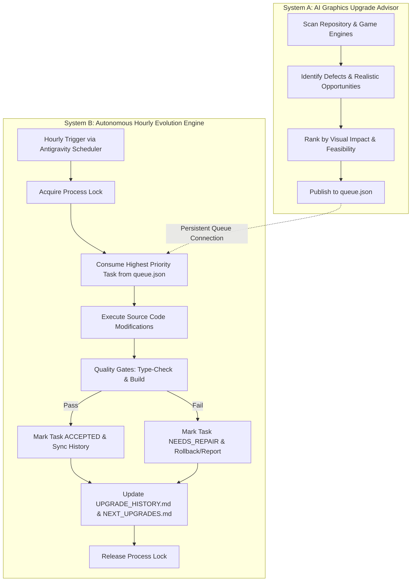

# Integration Architecture: System A & System B

## Overview
The AquaSpin Graphics Evolution System unifies two complementary engines:
1. **System A — AI Graphics Upgrade Advisor (`scripts/graphics-advisor.ts`)**: Scans repository components, determines visual limitations and defects, calculates prioritization, and publishes concrete recommendations to `docs/graphics-evolution/queue.json`.
2. **System B — Autonomous Hourly Graphics Evolution Engine (`scripts/hourly-evolution.ts`)**: Invoked hourly via Antigravity's scheduled sidecar. It consumes the prioritized queue, acquires a process lock to avoid concurrency collisions, tests the candidate upgrade, checks quality gates via TypeScript and build tests, and logs verification status to `history.json` and human-readable documentation.

## Architecture Diagram

## Task Lifecycle States
`DISCOVERED` → `PRIORITIZED` → `QUEUED` → `IN_PROGRESS` → `TESTING` → `ACCEPTED` (or `NEEDS_REPAIR` / `REJECTED`)
